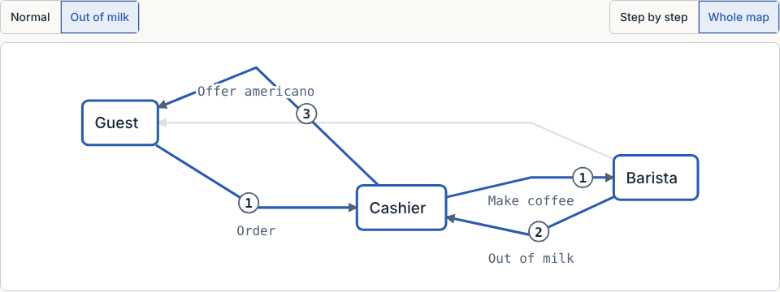

# Quality baseline

`check(source, resolved)` judges a drawn map. This folder records its report
for the 23 hand-drawn book maps and for the three examples laid out by dagre
and by ELK, so later layout work can be measured against it.

- [`book.json`](book.json) and [`examples.json`](examples.json): full reports,
  including tight contacts. `test/unit/report/check.test.ts` fails when a
  report changes, so a change to the drawings or to the check shows up here.
- Regenerate: `npm run build && node scripts/quality-baseline.mjs`.

## How to read the table

Columns from "Label × label" to "Line × box" count contacts in the `defect`
band: two drawn things overlap by more than 0.1 em of the arrow-label text
(10.5 units), well beyond the fraction of a pixel by which browsers differ.
Contacts between an overlap of 0.1 em and a gap of 0.25 em are `tight`; they
are in the JSON, not in the table. Crossings are a fact, not a defect.
Reading direction is the share of the first scenario's arrows that point down
(or right, for maps that declare `direction: "right"`); the book maps declare
no direction, and some of them (3-3, 5-1) are drawn from left to right.

The check judges the complete map: every scenario's labels and step numbers
at once, at the positions stored in the map, with text measured by the font
tables. The player can hide labels of other scenarios and move step numbers
away from labels after fonts load; those changes are not part of this report.

| Map          | Hard | Label × label | Label × line | Label × box | Step × label | Step × box | Step × step | Line × box | Crossings | Reading direction |
| ------------ | ---- | ------------- | ------------ | ----------- | ------------ | ---------- | ----------- | ---------- | --------- | ----------------- |
| coffee dagre | 1    | 0             | 1            | 0           | 0            | 0          | 0           | 0          | 1         | 0.667             |
| coffee elk   | 0    | 0             | 0            | 0           | 0            | 0          | 0           | 0          | 0         | 0.667             |
| door dagre   | 3    | 0             | 3            | 0           | 0            | 0          | 0           | 0          | 0         | 0.667             |
| door elk     | 1    | 0             | 0            | 0           | 0            | 0          | 1           | 0          | 0         | 0.667             |
| gcd dagre    | 6    | 0             | 0            | 0           | 0            | 0          | 6           | 0          | 0         | 0.8               |
| gcd elk      | 6    | 0             | 0            | 0           | 0            | 0          | 6           | 0          | 0         | 0.8               |
| book 0-1     | 4    | 0             | 1            | 0           | 0            | 1          | 0           | 2          | 5         | 0.643             |
| book 1-1     | 0    | 0             | 0            | 0           | 0            | 0          | 0           | 0          | 0         | 0.444             |
| book 1-2     | 0    | 0             | 0            | 0           | 0            | 0          | 0           | 0          | 0         | 0.833             |
| book 1-3     | 0    | 0             | 0            | 0           | 0            | 0          | 0           | 0          | 0         | 0.6               |
| book 2-1     | 0    | 0             | 0            | 0           | 0            | 0          | 0           | 0          | 0         | 0.556             |
| book 2-2     | 0    | 0             | 0            | 0           | 0            | 0          | 0           | 0          | 0         | 0.9               |
| book 2-3     | 5    | 0             | 1            | 0           | 0            | 4          | 0           | 0          | 0         | 0.643             |
| book 2-4     | 0    | 0             | 0            | 0           | 0            | 0          | 0           | 0          | 3         | 0.833             |
| book 2-5     | 0    | 0             | 0            | 0           | 0            | 0          | 0           | 0          | 0         | 1                 |
| book 2-6     | 1    | 0             | 0            | 0           | 0            | 1          | 0           | 0          | 1         | 0.917             |
| book 3-1     | 1    | 0             | 0            | 0           | 0            | 0          | 1           | 0          | 1         | 1                 |
| book 3-2     | 0    | 0             | 0            | 0           | 0            | 0          | 0           | 0          | 1         | 0.8               |
| book 3-3     | 0    | 0             | 0            | 0           | 0            | 0          | 0           | 0          | 0         | 0                 |
| book 4-1     | 0    | 0             | 0            | 0           | 0            | 0          | 0           | 0          | 1         | 0.75              |
| book 4-2     | 0    | 0             | 0            | 0           | 0            | 0          | 0           | 0          | 0         | 0.455             |
| book 4-3     | 0    | 0             | 0            | 0           | 0            | 0          | 0           | 0          | 0         | 0.615             |
| book 4-4     | 0    | 0             | 0            | 0           | 0            | 0          | 0           | 0          | 4         | 0.636             |
| book 4-5     | 2    | 0             | 0            | 0           | 0            | 2          | 0           | 0          | 1         | 0.5               |
| book 4-6     | 0    | 0             | 0            | 0           | 0            | 0          | 0           | 0          | 0         | 0.5               |
| book 5-1     | 0    | 0             | 0            | 0           | 0            | 0          | 0           | 0          | 0         | 0.111             |
| book 5-2     | 0    | 0             | 0            | 0           | 0            | 0          | 0           | 0          | 1         | 0.9               |
| book 6-1     | 0    | 0             | 0            | 0           | 0            | 0          | 0           | 0          | 1         | 0.714             |
| book 6-2     | 1    | 0             | 0            | 1           | 0            | 0          | 0           | 0          | 0         | 1                 |

## What the defects are

The defects found on the examples are visible in the player:

- **gcd, both engines (6).** In Whole map the loop arrow's own number and the
  numbers of its three repeated passes are drawn at one point, so only the
  last one shows ("4" on Repeat).
  
- **door, dagre (3).** Lines cross "turnKey [key] / unlock", "turnKey [key] /
  lock" and "push [true] / close".
  
- **coffee, dagre (1).** In Out of milk the Offer americano arrow runs through
  its own label.
  
- **door, ELK (1).** Two step numbers overlap.

The hand drawings are not free of defects either: in 2-3 and 4-5 step numbers
sit across the edges of neighbouring boxes; in 0-1 a step number and two
lines pass over a box; in 3-1 two step numbers overlap; in 6-2 a label covers
a box.

Screenshots: Chromium, the published 0.2.0 package, Whole map mode.
