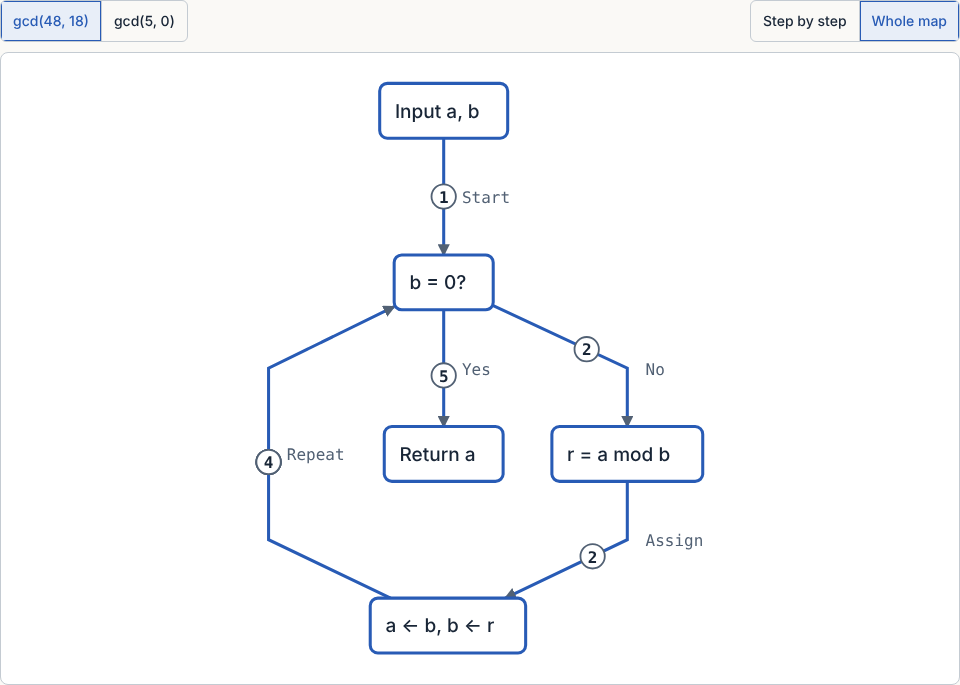
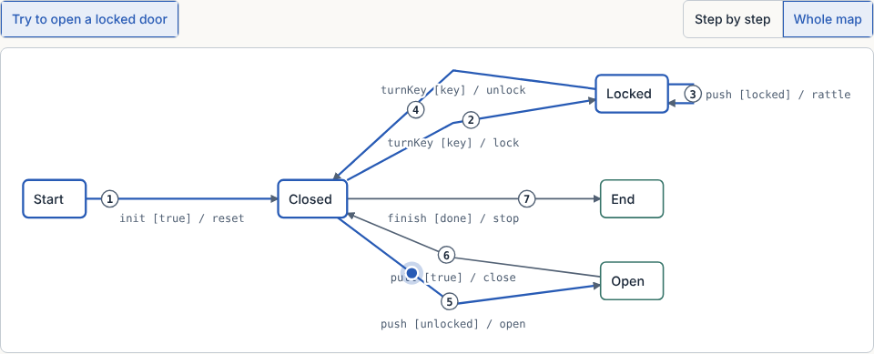

# Quality baseline

`check(source, resolved)` judges a drawn map. This folder records its report
for the 23 hand-drawn book maps and for the three examples laid out by dagre
and by ELK, so later layout work can be measured against it.

- [`book.json`](book.json) and [`examples.json`](examples.json): full reports,
  including tight contacts. `test/unit/report/check.test.ts` fails when a
  report changes, so a change to the drawings or to the check shows up here.
- Regenerate: `npm run build && node scripts/quality-baseline.mjs`.

## How to read the table

Columns from "Label × label" to "Line × box" count contacts in the `defect`
band: two drawn things overlap by more than 0.1 em of the arrow-label text
(10.5 units), well beyond the fraction of a pixel by which browsers differ.
Contacts between an overlap of 0.1 em and a gap of 0.25 em are `tight`; they
are in the JSON, not in the table. Crossings are a fact, not a defect.
Reading direction is the share of the first scenario's arrows that point down
(or right, for maps that declare `direction: "right"`); the book maps declare
no direction, and some of them (3-3, 5-1) are drawn from left to right.

The check judges the complete map: every scenario's labels and step numbers
at once, at the positions stored in the map, with text measured by the font
tables. The player can hide labels of other scenarios and move step numbers
away from labels after fonts load; those changes are not part of this report.

| Map          | Hard | Label × label | Label × line | Label × box | Step × label | Step × box | Step × step | Line × box | Crossings | Reading direction |
| ------------ | ---- | ------------- | ------------ | ----------- | ------------ | ---------- | ----------- | ---------- | --------- | ----------------- |
| coffee dagre | 1    | 0             | 1            | 0           | 0            | 0          | 0           | 0          | 1         | 0.667             |
| coffee elk   | 0    | 0             | 0            | 0           | 0            | 0          | 0           | 0          | 0         | 0.667             |
| door dagre   | 3    | 0             | 3            | 0           | 0            | 0          | 0           | 0          | 0         | 0.667             |
| door elk     | 0    | 0             | 0            | 0           | 0            | 0          | 0           | 0          | 0         | 0.667             |
| gcd dagre    | 0    | 0             | 0            | 0           | 0            | 0          | 0           | 0          | 0         | 0.8               |
| gcd elk      | 0    | 0             | 0            | 0           | 0            | 0          | 0           | 0          | 0         | 0.8               |
| book 0-1     | 4    | 0             | 1            | 0           | 0            | 1          | 0           | 2          | 5         | 0.643             |
| book 1-1     | 0    | 0             | 0            | 0           | 0            | 0          | 0           | 0          | 0         | 0.444             |
| book 1-2     | 0    | 0             | 0            | 0           | 0            | 0          | 0           | 0          | 0         | 0.833             |
| book 1-3     | 0    | 0             | 0            | 0           | 0            | 0          | 0           | 0          | 0         | 0.6               |
| book 2-1     | 0    | 0             | 0            | 0           | 0            | 0          | 0           | 0          | 0         | 0.556             |
| book 2-2     | 0    | 0             | 0            | 0           | 0            | 0          | 0           | 0          | 0         | 0.9               |
| book 2-3     | 5    | 0             | 1            | 0           | 0            | 4          | 0           | 0          | 0         | 0.643             |
| book 2-4     | 0    | 0             | 0            | 0           | 0            | 0          | 0           | 0          | 3         | 0.833             |
| book 2-5     | 0    | 0             | 0            | 0           | 0            | 0          | 0           | 0          | 0         | 1                 |
| book 2-6     | 1    | 0             | 0            | 0           | 0            | 1          | 0           | 0          | 1         | 0.917             |
| book 3-1     | 1    | 0             | 0            | 0           | 0            | 0          | 1           | 0          | 1         | 1                 |
| book 3-2     | 0    | 0             | 0            | 0           | 0            | 0          | 0           | 0          | 1         | 0.8               |
| book 3-3     | 0    | 0             | 0            | 0           | 0            | 0          | 0           | 0          | 0         | 0                 |
| book 4-1     | 0    | 0             | 0            | 0           | 0            | 0          | 0           | 0          | 1         | 0.75              |
| book 4-2     | 0    | 0             | 0            | 0           | 0            | 0          | 0           | 0          | 0         | 0.455             |
| book 4-3     | 0    | 0             | 0            | 0           | 0            | 0          | 0           | 0          | 0         | 0.615             |
| book 4-4     | 0    | 0             | 0            | 0           | 0            | 0          | 0           | 0          | 4         | 0.636             |
| book 4-5     | 2    | 0             | 0            | 0           | 0            | 2          | 0           | 0          | 1         | 0.5               |
| book 4-6     | 0    | 0             | 0            | 0           | 0            | 0          | 0           | 0          | 0         | 0.5               |
| book 5-1     | 0    | 0             | 0            | 0           | 0            | 0          | 0           | 0          | 0         | 0.111             |
| book 5-2     | 0    | 0             | 0            | 0           | 0            | 0          | 0           | 0          | 1         | 0.9               |
| book 6-1     | 0    | 0             | 0            | 0           | 0            | 0          | 0           | 0          | 1         | 0.714             |
| book 6-2     | 1    | 0             | 0            | 1           | 0            | 0          | 0           | 0          | 0         | 1                 |

## The author's rule on box edges

A step number or a label must not cross the edge of a box, even by a couple
of units. The tolerance of 0.1 em (about one unit at the default size) only
absorbs the fraction of a pixel by which browsers place text differently; it
is not room for drawings. So the hand-drawn maps 2-3 and 4-5, where step
numbers overlap neighbouring boxes by about 2 units, are reported as defects
on purpose.

## What the original defects looked like

These pictures show version 0.2.0, before shared number placement:

- **gcd, both engines (6).** In Whole map the loop arrow's own number and the
  numbers of its three repeated passes are drawn at one point, so only the
  last one shows ("4" on Repeat).
  
- **door, dagre (3).** Lines cross "turnKey [key] / unlock", "turnKey [key] /
  lock" and "push [true] / close".
  
- **coffee, dagre (1).** In Out of milk the Offer americano arrow runs through
  its own label.
  
- **door, ELK (1).** Two step numbers overlap.

The hand drawings are not free of defects either: in 2-3 and 4-5 step numbers
sit across the edges of neighbouring boxes; in 0-1 a step number and two
lines pass over a box; in 3-1 two step numbers overlap; in 6-2 a label covers
a box.

Screenshots: Chromium, the published 0.2.0 package, Whole map mode.

## Shared number placement

Server layout and browser refinement now use the same number-placement stage.
Each placed number becomes an obstacle for the following numbers, including
repeated passes. Candidate selection and rectangle clearance are shared with
the route seeds that determine the viewport. Keeping those seeds preserves
node boxes, lanes, frames and view boxes. No route or arrow-label position
changes in this update.

All changed hard counts are listed below. Chromium, Firefox and WebKit
each have the counts in the browser columns.

| Map  | Engine | Server before → after | Browser 1280 px before → after | Browser 390 px before → after |
| ---- | ------ | --------------------- | ------------------------------ | ----------------------------- |
| door | dagre  | 3 → 3                 | 5 → 5                          | 18 → 17                       |
| door | ELK    | 1 → 0                 | 4 → 3                          | 31 → 29                       |
| gcd  | dagre  | 6 → 0                 | 6 → 0                          | 6 → 0                         |
| gcd  | ELK    | 6 → 0                 | 6 → 0                          | 6 → 0                         |

Coffee stays at 1/0 on the server and at 1280 px, and 5/6 at 390 px
(dagre/ELK). The 23 hand drawings retain their recorded server reports: 14
hard defects in total. Applying font-table refinement to them also never
increases a count: 0-1 changes 4 → 3, 2-3 changes 5 → 1, 2-6 and 3-1 change
1 → 0, and 4-5 changes 2 → 0; all other counts stay equal.

The original real-font JSON reports remain the regression reference. Tests
reject every new defect identity and explicitly assert each removed pair:
the six pairs among the loop number and three repeat numbers in gcd; door's
open/unlock pair with ELK at 1280 px; open/close in both engines at 390 px;
and lock/unlock with ELK at 390 px. The fixed-geometry hashes come from the
unchanged drawing before this update. Strict-layout rejection uses synthetic
collisions so that repairing an example cannot break its test.

The layout consumer grows from 36,245 to 36,613 bytes gzip (+368 bytes).
Its limit rises by 450 bytes, from 36,250 to 36,700, within the author's
1 KB allowance for replacing duplicate number search. Player and component
limits do not change: measured sizes are 9,856 and 42,342 bytes respectively.
There is one candidate search; route and radial candidate generation stay
separate because route seeds preserve the viewport, while refinement is
bounded by that viewport.

Reproduce with `npm run verify`, `npm run build && node scripts/quality-baseline.mjs`,
and `FONT_EVIDENCE_DIR=/tmp/font-reports npx playwright test test/browser/refine.spec.ts`.
The browser suite checks every scenario, step and whole-map view at both widths.
Pictures for this update are captured separately in Chromium, light theme:
door/ELK and both gcd drawings at 1280 px, plus both door and gcd drawings
at 390 px. They are not committed to the repository.
